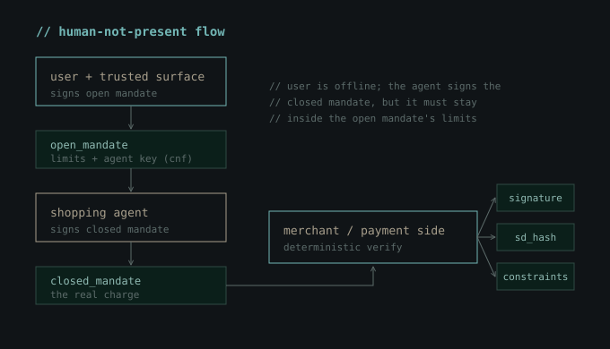
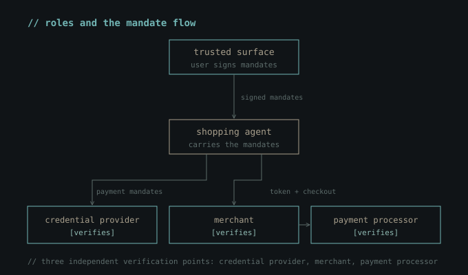
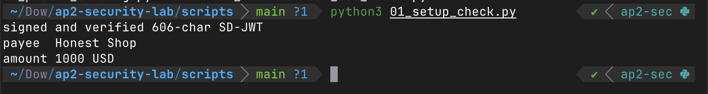
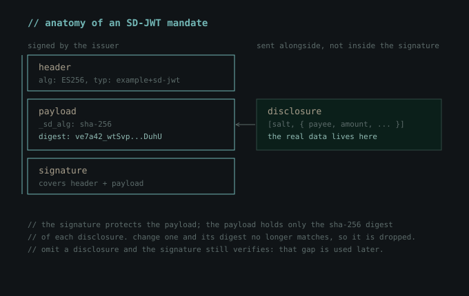
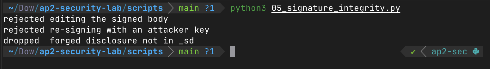
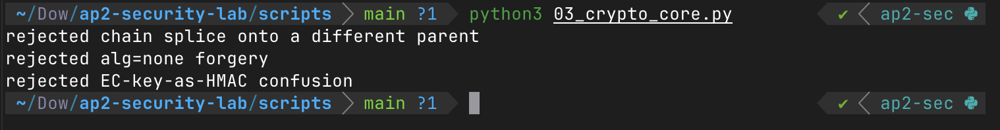
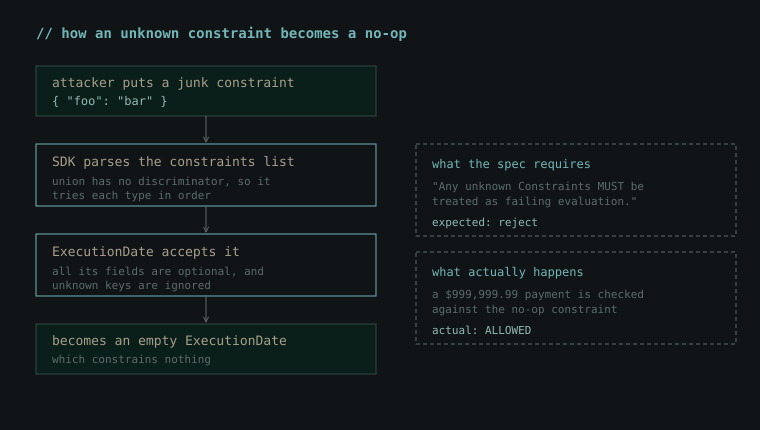
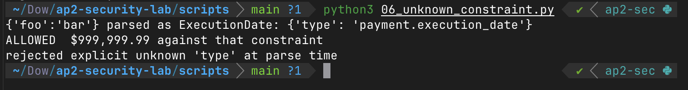
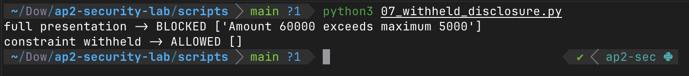
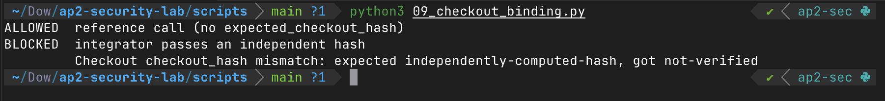

## TLDR;

AI agents are starting to pay on our behalf, and Google's Agent Payments Protocol (AP2) is one attempt to make that safe. Most security research on it asks the same question: how do we trick the LLM? I wanted to ask a different one. If the agent is already compromised, does the protocol's cryptographic mandate layer still protect you?

AP2's own security document is blunt about the threat model:

> "AP2 assumes that preventing prompt injection attacks is infeasible. Therefore, all LLMs and Agents MUST be considered potential attackers and are explicitly included in the threat model."

So I built a hands-on lab against the reference SDK and went through it from an integrator's point of view: which checks the SDK performs for you, and which ones it quietly leaves to you. The cryptographic core holds. But several checks the spec implies are left to whoever integrates the SDK, and a mandate can verify cleanly while the user's limits go unenforced.

Most of the behaviors here are not new; they're logged in AP2's own issue tracker, and some were reviewed by Google and marked as "intended behavior." One of them I couldn't find reported anywhere, so I reported it myself. This post is not a "0-day disclosure." It gathers these scattered behaviors into a single working lab and shows what they mean if you build on AP2: the SDK verifying a mandate without error does not mean your constraints were enforced, so the checks the spec leaves implicit are yours to make explicit.

## AP2
Before we move on to our scenarios, we need to understand the protocol itself a bit. Why it’s used, how it’s used, and so on.

### The Problem
AI agents are now present in every aspect of our lives. They write code for us, perform analyses, handle technical tasks, conduct security tests, and organize our daily lives. Of course, it’s only natural to imagine AI agents making purchases for us during this period (or in the near future).

How will the merchant and the payment processor know that this agent has actually been authorized by you for this transaction, within the limits you set? This is where both the problem and the solution were born.

The Agent Payment Protocol (AP2), developed by Google, provides a solution to this problem. The trust mechanism here is based not on the Agent, but on the mandates signed by the user. At this point, we encounter two types of mandates.
* **Checkout Mandate:** What is being purchased (product, seller, price).
* **Payment Mandate:** How the payment is made.

The two are tied to the same checkout. The merchant signs the checkout as a JWT (**checkout_jwt**), and both mandates carry a hash of it: the Checkout Mandate in a field called **checkout_hash**, and the Payment Mandate in a field called **transaction_id**. This shared value is what links a payment to one specific checkout.

> In AP2 v0.1 (September 2025), there were three mandates: the Cart Mandate, the Intent Mandate, and the Payment Mandate. Google’s announcement blog still uses this old term, “Intent Mandate.” v0.2 (April 2026) combined the Cart and Intent mandates into a single Checkout Mandate. Everything in this article is based on v0.2.

### Open and Closed Mandates
An **open mandate** is a pre-authorization. It includes constraints such as “Buy these shoes from these stores if the price drops below $100.” It also contains the agent’s public key (in a field called the **cnf claim**). This ensures that only that agent can use that open mandate.


A **closed mandate** is a specific transaction that has taken place. It is linked to the open mandate via an **sd_hash**. (sd_hash is the hash that links the closed mandate to the open mandate from which it originated.)

Additionally, to better understand how AP2 works, it’s helpful to be familiar with the **Human Present** and **Not Human Present** workflows.

In the “Human Present” workflow, the user is physically present at that moment and approves the closed mandate themselves.


In the “Not Human Present” workflow, the user signs the open mandate in advance, and then the agent operates autonomously to generate the closed mandate using its own key.



### Cryptographic Layer
Mandates are transmitted in <a href="https://datatracker.ietf.org/doc/rfc9901/" target="_blank" rel="noopener noreferrer">SD-JWT</a> format. In a standard signed JWT, all fields are exposed. SD-JWT, on the other hand, allows each field to be “hidden” individually. For instance, when verifying a mandate, you can show only the “$100 limit” portion without revealing your card number.

When it comes to validation, however, the protocol draws a clear line on this issue. At the validation stage, every check must be performed by the code. It should not be left to the agent’s discretion. In fact, the protocol stipulates that if an unrecognized constraint is detected, the validation process must not consider the operation valid.

### AP2 Roles
There are five different roles in AP2. A single company can take on several of them at once.

* **Shopping Agent:** An AI agent that makes purchases on behalf of the user.
* **Merchant:** The seller.
* **Credential Provider:** The party that stores the user’s payment information (card, etc.).
* **Merchant Payment Processor:** The party that processes the payment.
* **Trusted Surface:** The interface that obtains the user’s consent. It is deterministic and kept outside the LLM's control, since the user's approval and signature happen here. The spec gives examples such as a deterministic part of the shopping app, a standalone wallet, or the browser or mobile platform itself.

Verification is not performed at a single location, but at three independent points (Credential Provider, Merchant, Payment Processor). Each of them checks the signature, the sd_hash binding, and the constraints at the code level.



## Creating Lab
To start exploring the protocol, we need to set up a small lab. Everything I’ll cover later in this article is based on this lab. I’ve uploaded the lab to the <a href="https://github.com/mhmtayberk/ap2-security-lab" target="_blank" rel="noopener noreferrer">AP2-Security-Lab Repo</a> on my GitHub so you can try it out too.

### Installation
Simply follow the installation instructions below. These commands will install the virtual environment, the lab repository, and the AP2 SDK in that order. Note that the "pip install -e ." command must be run from the root directory of the AP2 repository.

```bash
python3 -m venv venv
source venv/bin/activate    # Windows: venv\Scripts\activate

git clone https://github.com/mhmtayberk/ap2-security-lab.git
cd ap2-security-lab

git clone https://github.com/google-agentic-commerce/AP2.git
cd AP2
pip install -e .
cd ..
```

> This lab was written against AP2 at commit **e1ea56d** (spec v0.2) with Pydantic 2.12.5. The repository is active and its generated model can change, so the **git checkout** above pins the exact state described in this post. Without it, a newer commit may make a script behave differently from what you read here.

### Verification and First Mandate
Let's verify that the installation is working using 01_setup_check.py. The script signs a Payment Mandate and then verifies it.

```python
signing_key = JWK.from_pyca(ec.generate_private_key(ec.SECP256R1()))
public_key = JWK.from_json(signing_key.export_public())

mandate = PaymentMandate(
    transaction_id="tx-123",
    payee=Merchant(name="Honest Shop", id="shop-1"),
    payment_amount=Amount(amount=1000, currency="USD"),
    payment_instrument=PaymentInstrument(id="pi-1", type="credit"),
)

token = sd_jwt.create(payload=mandate, issuer_key=signing_key).sd_jwt_issuance
resolved = sd_jwt.verify(token, public_key)
```



What’s happening here is that the **sd_jwt.create** method signs the mandate with an **EC key** to generate an **SD-JWT**, and then **sd_jwt.verify** verifies the signature using the public key of the same key and returns the data contained within it.

That's all. Our lab environment is ready. If you'd like, you can take a closer look at the GitHub repository.

## The Protocol's Secure Side
I do not claim that the protocol itself is “very insecure.” Many aspects have been considered from a security standpoint. However, the security of a product, structure, or system is not solely determined by how secure the system itself is. With AP2, we will see what kinds of vulnerabilities can arise if integrators do not implement the protocol correctly. To that end, I’d like to show you a bit more closely how signature integrity and constraints work.

### Signature Integrity
Suppose the agent has already been compromised or manipulated. In that case, could the threat actor alter the contents of the mandate signed by the user? For example, could they increase the payment amount or replace the recipient with their own account?

We already know that the Mandate is carried as an SD-JWT. Its structure consists of three parts. These are:
* Signed Header
* Signed Body
* Disclosure



In this setup, we will test three different scenarios. We will attempt to directly modify the signed body, test whether an attacker can sign a fake mandate using their own key, and attempt to inject a fake disclosure that inflates the amount.

Our **05_signature_integrity.py** script tests all three of these scenarios.



Our first two scenarios fail during direct signature verification. Our last scenario, however, fails because the digest of the fake disclosure is not in the digest list in the body-that is, in the **_sd** field. As a result, the verification process does not include it in the payload at all.

In other words, the signature layer does its job. Once a mandate is signed, its content cannot be altered; a mandate with a forged signature or falsified content will not be accepted.

### Chain Binding and The Signature Algorithm
In the “human-not-present” workflow, the agent’s closed mandate is appended to the open mandate signed by the user and is linked to it in two ways. The closed mandate is signed with the agent’s key contained within the open mandate, and it contains the cryptographic hash of the open mandate. So, could an attacker take a valid closed mandate and paste it into another user’s open mandate?

The answer is no. The signature does not match the key for that new open mandate, and the hash it carries does not match either. Both checks fail at the same time.

On the other hand, there are classic attack methods in JWT-based systems. These include setting the algorithm to **alg=none** to completely disable the signature, or tricking the verifier into treating the public key as a password (algorithm confusion).

Since the signature library used by AP2 can distinguish between key types, both attacks fail.



## Some Risky Concepts
So far we have only looked at the parts that hold. The signature keeps a mandate from being changed, and a separate, deterministic constraint check enforces the limits the user signed (you can see that check working in **02_constraint_enforcement.py** in the repo). Both guarantees rest on two assumptions: the verifier sees the complete mandate, and it actually runs every check.


In this section, however, I will address some risky scenarios arising from incorrect integration by the integrator, situations where the prerequisites are not met.

> I didn't discover most of these behaviors; they're already logged in AP2's own issue tracker. The exception is the unknown constraint case below, which I reported in [issue #395](https://github.com/google-agentic-commerce/AP2/issues/395). What I'm doing here is bringing them together in a working lab and showing what they mean for an integrator.

### The Unknown Constraint
There is a clear requirement in the <a href="https://ap2-protocol.org/ap2/agent_authorization/#verification-and-processing-rules" target="_blank" rel="noopener noreferrer">AP2 specification</a>. When a verifier encounters an unknown constraint, it must not treat it as valid; it must treat it as a failure.

> “Any unknown Constraints MUST be treated as failing evaluation.”

The constraints of an open mandate are modeled in the SDK as a **Pydantic union**, and this union has no discriminator. Additionally, all fields of **ExecutionDate** (one of the constraint types) are optional.

When these two conditions occur together, the result is that when we pass a constraint object with no known fields to the SDK, instead of rejecting it, the SDK silently converts it into an empty ExecutionDate. An empty ExecutionDate, however, does not constrain anything.



Let's test this case using our **06_unknown_constraint.py** script.



As the output shows, a payment of almost one million dollars passes a constraint that should have failed. I couldn't find this specific path reported anywhere, so I reported it myself in [issue #395](https://github.com/google-agentic-commerce/AP2/issues/395). The root cause is a mismatch between the schema and the generated model: the schema marks each constraint's **type** as required, but the generated model gives **ExecutionDate.type** a default value, so an object with no known fields is accepted as an empty ExecutionDate instead of being rejected.

### The Withheld Constraint
Let’s take a moment here to recall the structure of the SD-JWT we discussed in the first sections of this article. In a mandate, the signature protects only the payload, but the actual data (amount, merchant, constraints) is stored in separate disclosure blocks. The payload contains only a digest of each block. In this scenario, the party presenting the mandate to the other party can withhold some of the disclosure blocks, and the signature will still remain valid. This is actually a feature intended by SD-JWT.

The problem is that a constraint could also be one of the blocks that can be hidden in this way. In the “human-not-present” flow, the Shopping Agent is the one who presents the mandates to the other party, and according to our threat model, the agent may have been compromised. A compromised agent could hide a constraint signed by the user during the presentation. The signature remains intact because hiding a disclosure does not affect the signature. And since AP2’s verification evaluates only the constraints presented to it, the hidden constraint is treated as if it did not exist.

In our **07_withheld_disclosure.py** script, we test this case. Our scenario is as follows: a user signs an open mandate for a maximum of $50. When the compromised agent presents this mandate to the credential provider, it omits the disclosure of the $50 limit. It then attempts a payment of $600.



The output has two lines. The first is the baseline. The agent presents the full mandate, the $50 limit is visible, and the $600 payment is blocked. The second is the attack. The same mandate and the same $600 payment, but the disclosure holding the limit is left out, and the payment goes through. The signature is valid in both cases. The only difference is whether the constraint was shown.

### Checkout Binding Verification
Before getting into the details of this case, it’s worth taking a moment to review the structure of AP2. There were two different mandates in a payment transaction. **Checkout Mandate**, which specifies what was purchased, and **Payment Mandate**, which specifies how the payment was made. Checkout Mandate contains a **checkout_jwt** signed by the merchant and a **checkout_hash** associated with that checkout. The AP2 specification requires the merchant to verify that the hash of the checkout_jwt matches the checkout_hash.

On the SDK side, this verification is optional. The **CheckoutMandateChain.verify** function takes a parameter called **expected_checkout_hash**, but if this parameter is not provided, the checkout_hash check is skipped entirely. Furthermore, the SDK does not verify the merchant’s signature on checkout_jwt anywhere; it only reads the data inside it. In other words, both checks are left to the integrator.

We will test this case using our **09_checkout_binding.py** script. We are preparing a checkout mandate with both a fake merchant signature and a fake checkout_hash value, and run the verification in two ways. First, without providing an expected_checkout_hash (as the reference example does) and then by providing an independently calculated hash, as the integrator should do.



## Is That All?
Not at all. Throughout this blog post, we’ve discussed some of AP2’s secure approaches, the approaches left to the integrator’s discretion despite being specified in the documentation, and the consequences that faulty integrations can lead to. There are numerous issues in Google’s AP2 GitHub repository.

* Once a closed Payment Mandate is accepted, it is not marked as “used,” meaning the same user consent can be reused for multiple payments (issue #346).
* Merchant ID matching relies on fields that appear to be editable (such as name) if a fixed ID is not available (issue #315).
* The currency budget assumes that each currency has 100 subunits, so the limit is inflated by a factor of 100 for currencies with zero decimal places, such as JPY (issues #362, #389).

Some, like the withheld disclosure, Google has already reviewed and classified as intended behavior rather than something to fix, because the protocol’s threat model assumes the agent can be hostile and pushes that responsibility onto the integrator.

The point is this; in this protocol, security does not come solely from the signature; it comes from the integrator plugging the gaps in their own code that the signature does not guarantee.

## The Integrator's Checklist

Everything above comes down to a handful of concrete controls. The SDK's defaults are permissive: supply every check it treats as optional, and perform every check it never does.

* **Do not read an empty violation list as a passed check.** After the SDK parses a mandate, confirm that each constraint resolved to the exact type you expect and still carries its bounds. A limit that comes back as an empty **ExecutionDate** has been silently dropped, not satisfied. Until the parse-time behavior is fixed (tracked in [issue #395](https://github.com/google-agentic-commerce/AP2/issues/395)), validate the resolved constraints yourself instead of trusting the parse.
* **Require the limits you expect to be present, and fail closed when one is missing.** A selectively disclosable field can be withheld without breaking the issuer signature, and the verifier evaluates only what it is shown. Close this on two sides: at issuance, keep security-critical limits out of the selectively disclosable set so they always travel in the signed body; at verification, decide in advance which limits a mandate must carry and reject the presentation if any is absent. Reaching for a preset does not help here, because a preset payee or amount is itself an optional field that parses as absent once its disclosure is withheld.
* **Bind the checkout yourself.** Compute the hash of the merchant's **checkout_jwt** and pass it as **expected_checkout_hash** to **CheckoutMandateChain.verify**, together with the **checkout_jwt** so the constraints are evaluated rather than skipped. Verify the merchant's signature on the **checkout_jwt** on your own, because the SDK only reads its contents and never checks that signature.
* **Normalize currency amounts before you trust a budget.** The SDK's budget cap assumes every currency has 100 minor units, so for a zero-decimal currency such as JPY the effective limit is inflated a hundredfold. Convert every amount to the correct minor-unit scale for its currency before comparing, and restrict the currencies you accept to the ones you have tested.
* **Treat an accepted mandate as spent.** A closed Payment Mandate is not marked as used once it is accepted, so the same user consent can settle more than once (issue #346). Record the transaction identifiers you have already honored and reject a repeat, rather than relying on the protocol to prevent replay.
* **Match the merchant on an identifier that cannot be edited.** If either side is missing a merchant id, the SDK falls back to matching on the name and website fields, both of which an attacker can copy from a legitimate merchant (issue #315). Pin the merchant to a fixed, non-editable id and reject anything that does not match it.
* **Pin the SDK and watch what you depend on.** Every behavior here is tied to a specific commit, and the parts left to you can move in either direction as the SDK changes. Pin the version you integrated against, follow the issues behind the limits you rely on, and re-run your own checks on every upgrade instead of assuming a new release only fixes things.

## The Agent Side
Throughout this article, I have deliberately focused on a single layer: the cryptographic verification of mandates. But the attack surface for AP2 is not limited to this. There is also the aspect of the agent itself. Attacks such as tricking the agent into selecting a poor product via prompt injection, serving the agent a spoofed Agent Card, or misdirecting the user’s intent during the presentation phase constitute a separate area of research. There are both academic studies and articles by commercial security teams on this topic.

## Resources
If you’d like to learn more about AP2 or are curious about the sources I used while writing this blog post, I’ve included a list of them here.
* <a href="https://ap2-protocol.org/" target="_blank" rel="noopener noreferrer">AP2 Specification</a>
* <a href="https://cloud.google.com/blog/products/ai-machine-learning/announcing-agents-to-payments-ap2-protocol" target="_blank" rel="noopener noreferrer">Announcing Agent Payments Protocol (Google Cloud)</a>
* <a href="https://github.com/google-agentic-commerce/AP2" target="_blank" rel="noopener noreferrer">AP2 GitHub Repo</a>
* <a href="https://datatracker.ietf.org/doc/rfc9901/" target="_blank" rel="noopener noreferrer">SD-JWT (RFC 9901)</a>

## Last Word
If you have any suggestions for the article, please feel free to contact me through any communication channel (LinkedIn, Twitter, Threema, etc.). I am constantly updating the articles in line with your feedback.
